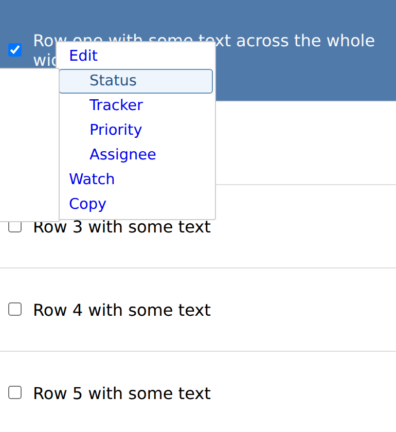
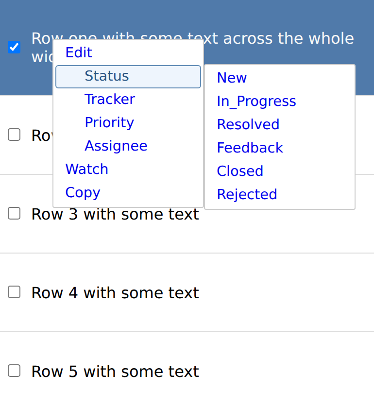

# Context menu fit

A Redmine plugin that keeps the issue list's right-click (long-press)
submenus (Status, Tracker, Priority…) inside the viewport.

| Before | After |
|---|---|
|  |  |

## The problem

Core Redmine decides once, when the menu opens, whether submenus open to the
right or to the left (`.reverse-x`), and only keeps the main menu on screen.
On a phone (~380 px wide) the main menu and a submenu need ~300 px side by
side, so for most tap positions the submenu ends up partly off screen. With
`dir="rtl"` the same check misplaces submenus even on desktop.

The plugin measures each submenu when it opens and moves it to the side that
fits. If neither side fits, it places it against the screen edge with more
room, overlapping the parent menu. Submenus that already fit are not touched.

## Installation

Requires Redmine 6.1 or later.

```sh
cd /path/to/redmine/plugins
git clone https://github.com/Plinsboorg/redmine_context_menu_fit.git
```

Restart Redmine. No migrations or settings.

## Upstream

The same fix is proposed for Redmine core as `contextMenuFitSubmenu()` in
`context_menu.js`. See [`upstream/`](upstream/) for the patch against trunk
and the ticket text (related: https://www.redmine.org/issues/5908). When core
defines that function, this plugin does nothing and can be removed.

## License

GPL-2.0, same as Redmine.
